<div align="center">

# 🌫️ Smog Navigator

### Breathe easier through smog season

A GenAI-powered assistant that helps families and communities navigate severe winter smog and urban air pollution, with low-emission routines, indoor air hacks and sustainable alternatives tailored to their city and lifestyle, and a clear explanation of the impact of every choice.

<!-- EDIT: replace YOUR-LINK with your Vercel URL -->
### 🔗 [**Live demo → https://airqualityassistant.vercel.app/ ]


</div>

<!-- EDIT: add a screenshot. Save it as docs/screenshot.png, then remove the comment markers below.
<p align="center"></p>
-->

---

## 📌 The problem

Every winter, millions of people in cities such as Delhi and Kolkata live under thick smog. Families know the air is bad, but not **what to change in their own daily life**, or **whether it would make any difference**. Generic advice ("stay indoors") ignores whether you own a purifier, how you commute, or what you cook with.

## 💡 The solution

Smog Navigator takes a short description of a household, fetches the **live air quality** for its city, and returns a **personalised plan**. Every tip comes with a plain-language, approximate **impact note**, so people can see what each action is likely to do for them.

## 👨‍👩‍👧 Who it is for

- Families with children or elderly members
- People with asthma or other respiratory conditions
- Neighbourhoods, schools and community groups in smog-affected cities

---

## ✅ Hackathon requirements and where they are met

| Requirement | How Smog Navigator delivers it | Code |
|---|---|---|
| **Tailored to location** | City is geocoded and live PM2.5 / US AQI is fetched for it | `lib/airQuality.ts` |
| **Low-emission daily routines** | Commute, outdoor-exercise timing and no-burning tips | `lib/llm.ts`, `lib/impact.ts` |
| **Indoor air quality hacks** | Windows, purifier and ventilation-timing tips | `lib/impact.ts` |
| **Sustainable alternatives** | Public transport, cycling or walking, cleaner cooking fuel | `lib/impact.ts` |
| **Tailored to lifestyle** | Actions already irrelevant to the user are removed in code (no purifier tip if they own one) | `getRelevantActionTypes` in `lib/llm.ts` |
| **Clearly explains direct impact** | Every tip shows a pre-written, approximate impact note with a confidence level | `lib/impact.ts`, `components/TipCard.tsx` |
| **Families and communities** | Household inputs for children, elderly and respiratory conditions; a safety rule protects them | `lib/advice.ts` |

---

## 🧭 How it works

```mermaid
flowchart LR
    A[Family fills in the form] --> B[POST /api/advice]
    B --> C[Validate input]
    C --> D[Geocode city and fetch live AQI]
    D --> E[Code picks relevant action types]
    E --> F[Gemini writes tips]
    F --> G[Validate and filter model output]
    G --> H[Safety rule for sensitive households]
    H --> I[Attach pre-written impact notes]
    I --> J[Plan shown with AQI badge]
```



1. **Input.** City, who lives at home, commute, cooking fuel and purifier status.
2. **Live data.** Current PM2.5, PM10 and US AQI come from Open-Meteo.
3. **Personalisation.** Code decides which actions make sense, and Gemini writes 6 to 8 tips explaining why each fits the family.
4. **Impact and safety.** Our own code attaches the impact note to each tip and enforces the safety rule.

---

## 🔬 No invented numbers

Language models can make up statistics, which is dangerous in a health context. So:

- The model **only chooses an action type** from a fixed list and explains why it suits the family.
- **Every impact statement comes from a fixed table** in `lib/impact.ts`, written with cautious wording.
- Any figure uses the word *approximately*, uncertain effects are described qualitatively, and each note carries a **confidence level** (low, medium or high).
- A unit test checks that every percentage in the table is marked as approximate.

## 🛡️ Safety rule (enforced in code)

If the air is **Unhealthy or worse** and the household includes children, elderly people or someone with a respiratory condition, the app **always** shows a "limit outdoor time" tip first, no matter what the model returned. A "not medical advice" disclaimer accompanies every plan.

---

## 📊 Evaluation criteria

### Code quality
- Thin API route: it parses, validates, calls one function and maps errors. Logic lives in `lib/`.
- One job per file, small functions, named constants, strict TypeScript with no `any`.
- A single source of truth for shared types and constant lists (`lib/types.ts`).
- Custom error classes with user-safe messages (`lib/errors.ts`).

### Problem statement alignment
See the requirements table above: each part of the brief maps to a concrete feature and file.

### Security
- The API key is read **only on the server** and sent in a request header, never in a URL or client code.
- Strict validation of every field, a character whitelist for the city, and a 2 KB request size limit.
- User text sits inside a delimited data block with delimiter tags stripped, and the model is told to ignore instructions in it (prompt-injection mitigation).
- Model output is parsed and validated, and unknown or duplicate action types are dropped.
- Errors shown to users are friendly and never contain stack traces or secrets.
- No user data is stored. No `dangerouslySetInnerHTML`. `.env.local` is git-ignored.

### Efficiency
- Exactly **one LLM call** per request, with a capped output length.
- Timeouts on every external call (8 s for air quality, 45 s for the LLM).
- Pure functions and a stateless API, so there is nothing to clean up or store.

### Testing
- Unit tests with Vitest cover the impact table, AQI breakpoints, request validation, prompt building, model-output parsing and the safety rule.
- Tests use only pure functions, so they need no network and no API key.

### Accessibility
- A real `<label>` for every input, and `fieldset` / `legend` for grouped checkboxes.
- AQI category and confidence level are shown as **text**, never by color alone.
- Visible focus rings, strong text contrast and a mobile-first layout.
- `aria-live` loading status, `role="alert"` errors, and focus moves to the results when they arrive.
- Logical heading order (`h1`, then `h2`, then `h3`).

---

## 🧱 Project structure

```text
app/
  page.tsx                 Landing page, form and results (client)
  api/advice/route.ts      Thin POST handler
components/
  Hero.tsx  HowItWorks.tsx  ProfileForm.tsx  AqiBadge.tsx  TipCard.tsx
lib/
  advice.ts                Orchestration, safety rule, impact attachment
  airQuality.ts            Geocoding, live AQI, AQI categories
  llm.ts                   Prompt building, Gemini call, output parsing
  impact.ts                Impact notes and action-type guard
  validation.ts            Request validation
  profile.ts               Household helpers
  errors.ts                Custom errors with user-safe messages
  types.ts                 Shared types and constant lists
tests/                     Vitest unit tests
```

##
