<div align="center">

# 🌍 AirWise

### Know your air. Act on it.

A GenAI-powered air quality assistant that helps families and communities navigate severe winter smog and everyday urban air pollution, with low-emission routines, indoor air hacks and sustainable alternatives tailored to their city and lifestyle, and a clear explanation of the impact of every choice.

<!-- EDIT: replace YOUR-LINK with your Vercel URL -->
### 🔗 **Live demo → https://airqualityassistant.vercel.app/


</div>

> **Quick test (10 seconds):** open the live demo, click **Try an example → Family in Delhi**, then **Get my clean-air plan**.

---

## 📌 The problem

Every winter, and often all year, millions of people in cities such as Delhi and Kolkata breathe polluted air. Families know the air is bad, but not **what to change in their own daily life**, or **whether it would make any difference**. Generic advice ("stay indoors") ignores whether you own a purifier, how you commute, or what you cook with.

## 💡 The solution

AirWise takes a short description of a household, fetches the **live air quality** for its city, and returns a **personalised plan**. Every tip comes with a plain-language, approximate **impact note**, so people can see what each action is likely to do for them.

## 👨‍👩‍👧 Who it is for

- Families with children or elderly members
- People with asthma or other respiratory conditions
- Neighbourhoods, schools and community groups in polluted cities

---

## ✅ Requirements and where they are met

| Requirement | How it is delivered | Code |
|---|---|---|
| **Tailored to location** | City is geocoded and live PM2.5 / US AQI is fetched for it | `lib/airQuality.ts` |
| **Low-emission daily routines** | Commute, outdoor-exercise timing and no-burning tips | `lib/prompt.ts`, `lib/impact.ts` |
| **Indoor air quality hacks** | Windows, purifier and ventilation-timing tips | `lib/impact.ts` |
| **Sustainable alternatives** | Public transport, cycling or walking, cleaner cooking fuel | `lib/impact.ts` |
| **Tailored to lifestyle** | Irrelevant actions are removed in code (no purifier tip if they own one) | `lib/actionFilter.ts` |
| **Clearly explains direct impact** | Every tip shows a pre-written, approximate impact note with a confidence level | `lib/impact.ts`, `components/TipCard.tsx` |
| **Families and communities** | Household inputs for children, elderly and respiratory conditions, plus a safety rule | `lib/advice.ts` |

---

## 🧭 How it works

```mermaid
flowchart LR
    A[Family fills in the form] --> B[POST /api/advice]
    B --> C[Validate input]
    C --> D[Geocode city and fetch live AQI - cached]
    D --> E[Code picks relevant action types]
    E --> F[Gemini writes tips - cached per household]
    F --> G[Validate and filter model output]
    G --> H[Safety rule for sensitive households]
    H --> I[Attach pre-written impact notes]
    I --> J[Plan shown with AQI badge]
```



1. **Input.** City, who lives at home, commute, cooking fuel and purifier status (or one click on an example household).
2. **Live data.** Current PM2.5, PM10 and US AQI come from Open-Meteo.
3. **Personalisation.** Code decides which actions make sense, and Gemini writes 6 to 8 tips explaining why each fits the family.
4. **Impact and safety.** Our own code attaches the impact note to each tip and enforces the safety rule.

## 🔬 No invented numbers

- The model **only chooses an action type** from a fixed list and explains why it suits the family.
- **Every impact statement comes from a fixed table** in `lib/impact.ts`, written with cautious wording.
- Any figure uses the word *approximately*, uncertain effects are described qualitatively, and each note carries a **confidence level**.
- A unit test checks that every percentage in the table is marked as approximate.

## 🛡️ Safety rule (enforced in code)

If the air is **Unhealthy or worse** and the household includes children, elderly people or someone with a respiratory condition, the app **always** shows a "limit outdoor time" tip first, no matter what the model returned. The rule runs on every request, including ones served from the tips cache. A "not medical advice" disclaimer accompanies every plan.

---

## 🧩 Edge cases handled

| Area | Handled cases |
|---|---|
| **Request** | Invalid JSON, oversized body (over 2 KB), body that is not an object |
| **Input** | Missing, empty or whitespace city, over 100 characters, unsafe characters, non-boolean flags, unknown commute or fuel values, extra fields ignored |
| **Location** | City not found returns a clear 404 message |
| **Air data** | Network failure, timeout, bad status, missing or non-numeric values, missing country, negative or NaN AQI, every AQI category boundary |
| **Model output** | Markdown fences, malformed JSON, non-array, invalid items, duplicate types, actions excluded for this household, overlong text, fewer than 3 valid tips |
| **Prompt injection** | Delimiter tags stripped from user-controlled text, which is placed in a data block the model is told to ignore |
| **Caching** | Expiry, size cap with eviction, failures never cached, case-insensitive city key, AQI category in the tips key so advice never goes stale across categories |
| **Safety** | Forced safety tip with no duplicates, skipped on good-air days and for adult-only households |
| **UI** | Double submit blocked, non-JSON server errors handled, empty state, example buttons that never submit by accident, reduced-motion support |

---

## 📊 Evaluation criteria

### Code quality
- Thin API route: it parses, validates, calls one function and maps errors. Logic lives in `lib/`.
- One job per file (see the structure below), small functions, named constants, strict TypeScript with no `any`.
- One shared HTTP helper with a timeout, so fetch logic exists once.
- A single source of truth for shared types and constant lists (`lib/types.ts`).
- Custom error classes with user-safe messages (`lib/errors.ts`).

### Problem statement alignment
See the requirements table above: each part of the brief maps to a concrete feature and file.

### Security
- The API key is read **only on the server** and sent in a request header, never in a URL or client code.
- Strict validation of every field, a character whitelist for the city, and a 2 KB request size limit.
- Prompt-injection mitigation (delimited data block, delimiter stripping), and model output is parsed and validated.
- Errors shown to users are friendly and never contain stack traces, keys or upstream response bodies.
- No user data is stored: caches hold only generic advice and air data, expire on their own, and are never written to disk. No `dangerouslySetInnerHTML`. `.env.local` is git-ignored.

### Efficiency
- Exactly **one LLM call** per uncached request, with a capped output length.
- **In-memory caching with expiry** for city locations (24 h), air quality (10 min) and generated tips (30 min, keyed by city, AQI category and household answers), so repeat requests skip upstream calls.
- Timeouts on every external call (8 s for air quality, 45 s for the LLM) through one shared helper.
- Stateless API, with nothing stored on disk.

### Testing
- Vitest unit tests cover the impact table, AQI breakpoints, request validation, action filtering, prompt building, model-output parsing, the safety rule, the cache, the air quality service with a mocked network, and the API route's rejection paths.
- No test needs the real network or an API key.

### Accessibility
- A real `<label>` for every input, and `fieldset` / `legend` for grouped checkboxes.
- AQI category and confidence level are shown as **text**, never by color alone.
- Visible focus rings, readable text contrast, 44px touch targets and a mobile-first layout.
- `aria-live` loading status, `role="alert"` errors, and focus moves to the results when they arrive.
- Logical heading order, and animations respect the reduced-motion setting.
- One-click example households reduce typing for people who find forms hard.

---

## 🧱 Project structure

```text
app/
  page.tsx                 Landing page, form and results (client)
  api/advice/route.ts      Thin POST handler
components/
  Hero.tsx  HowItWorks.tsx  ProfileForm.tsx  AqiBadge.tsx  TipCard.tsx
lib/
  advice.ts                Orchestration, tips cache, safety rule, impact attachment
  airQuality.ts            Geocoding, live AQI (cached), AQI categories
  actionFilter.ts          Which actions are relevant for this household
  prompt.ts                Prompt building and prompt-injection guard
  tipParser.ts             Parsing and validating model output
  llm.ts                   Gemini API call only
  http.ts                  Fetch with timeout, shared helper
  cache.ts                 In-memory cache with expiry and size cap
  impact.ts                Impact notes and action-type guard
  validation.ts            Request validation
  profile.ts               Household helpers
  errors.ts                Custom errors with user-safe messages
  types.ts                 Shared types and constant lists
tests/                     Vitest unit tests
vitest.config.ts           Test config (path alias)
```

## 🛠️ Tech stack

Next.js (App Router) · TypeScript · Tailwind CSS · Google Gemini API · Open-Meteo (geocoding and air quality, no key needed) · Vitest · Vercel

---

## 🚀 Run locally

```bash
git clone <your-repo-url>
cd <your-repo-folder>
npm install
```

Create `.env.local` from the example and add your free key from [Google AI Studio](https://aistudio.google.com):

```bash
# macOS / Linux
cp .env.example .env.local
# Windows PowerShell
Copy-Item .env.example .env.local
```

```text
LLM_API_KEY=your_key_here
```

```bash
npm run dev      # http://localhost:3000
npm test         # unit tests
npm run lint
npm run build
```

## ☁️ Deploy

1. Push the repository to GitHub.
2. Import it in [Vercel](https://vercel.com).
3. Add the environment variable `LLM_API_KEY`.
4. Deploy.

---

## ⚠️ Limitations and next steps

- Impact figures are **approximate and general**, not personalised medical estimates.
- Air quality comes from a free, model-based source and may differ from local monitoring stations.
- Caches live in each server instance's memory, so a cold start begins empty.
- There is no per-user rate limiting yet; a production version should add it.
- Future ideas: Hindi and Bengali support, hourly "best time to go out" guidance, and community-level tips for schools and housing societies.

> **Not medical advice.** Consult a doctor if symptoms appear.

---

<div align="center">


</div>
